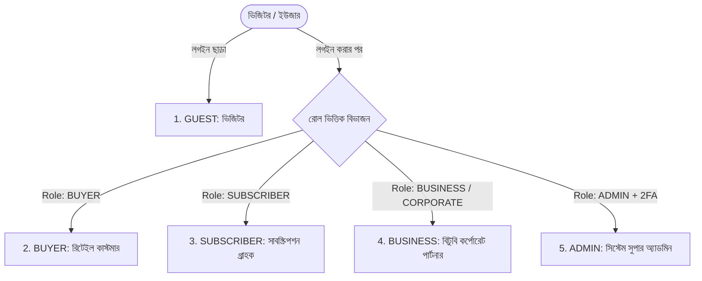
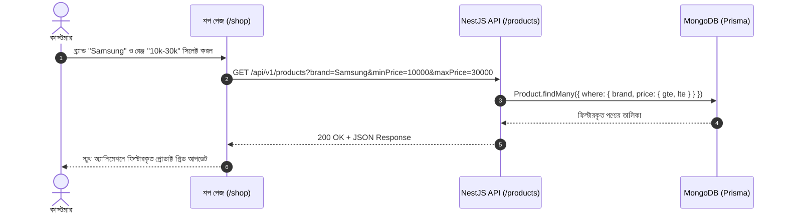
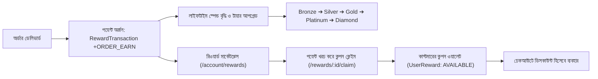
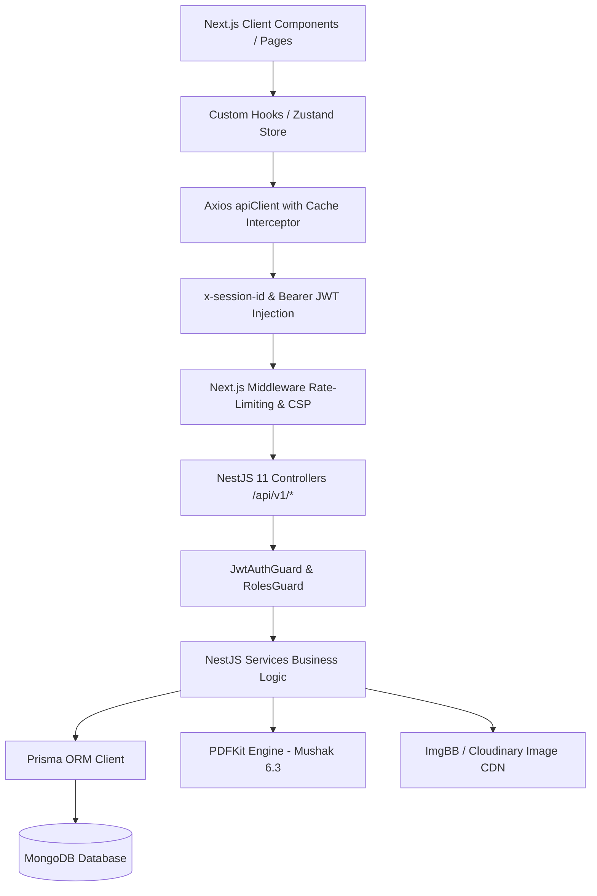

# 📘 Smart24 Corporate E-Commerce: সম্পূর্ণ মাস্টার ইউজার ও আর্কিটেকচার গাইড (Top-to-Bottom Documentation)

এই গাইডটি এমনভাবে সাজানো হয়েছে যাতে নতুন ডেভেলপার, প্রজেক্ট ম্যানেজার, QA ইঞ্জিনিয়ার বা যে কেউ এক নজরে বুঝতে পারেন **Smart24 প্ল্যাটফর্মের কোন ফিচার কীভাবে কাজ করে, কোন ইউজার রোল কী দেখতে পায়, প্রতিটি CRUD অপারেশনের ব্যাকএন্ড লজিক কী এবং ফ্রন্টএন্ডে তা ঠিক কোথায় কীভাবে রেন্ডার হয়।**

---

## 📑 সূচিপত্র (Table of Contents)
1. [সিস্টেম আর্কিটেকচার ও টেকনিক্যাল স্ট্যাক](#1-সিস্টেম-আর্কিটেকচার-ও-টেকনিক্যাল-স্ট্যাক)
2. [ইউজার রোল ও পারমিশন কন্ট্রোল (RBAC Matrix)](#2-ইউজার-রোল-ও-পারমিশন-কন্ট্রোল-rbac-matrix)
3. [কমপ্লিট সাইটম্যাপ ও পেজ নেভিগেশন ম্যাপ](#3-কমপ্লিট-সাইটম্যাপ-ও-পেজ-নেভিগেশন-ম্যাপ)
4. [ফিচারভিত্তিক কর্মপদ্ধতি ও কমপ্লিট CRUD ম্যাট্রিক্স (How Each Feature Works)](#4-ফিচারভিত্তিক-কর্মপদ্ধতি-ও-কমপ্লিট-crud-ম্যাট্রিক্স-how-each-feature-works)
   - 4.1 অথেনটিকেশন, ইমেইল ভেরিফিকেশন ও অ্যাডমিন 2FA
   - 4.2 প্রোডাক্ট ব্রাউজিং, ডাইনামিক ফিল্টার ও স্টক অ্যালার্ট
   - 4.3 কার্ট, গেস্ট সেশন ও উইশলিস্ট মেকানিজম
   - 4.4 চেকআউট, পেমেন্ট গেটওয়ে ও কুপন ভ্যালিডেশন
   - 4.5 B2B ভেরিফিকেশন, ক্রেডিট ওয়ালেট ও মূসক-৬.৩ ভ্যাট চালান
   - 4.6 B2B RFQ (Request for Quote) ও প্রাইস নেগোসিয়েশন
   - 4.7 সাবস্ক্রিপশন ও অটোমেটেড মান্থলি রিকারিং ডেলিভারি
   - 4.8 লয়্যালটি পয়েন্ট, মেম্বারশিপ টায়ার ও রিওয়ার্ড মার্কেটপ্লেস
   - 4.9 আফটার-সেলস: রিটার্ন, রিফান্ড ও ভেরিফাইড রিভিউ
   - 4.10 সাপোর্ট টিকেট ও কাস্টমার হেল্পডেস্ক
   - 4.11 হোমপেজ সিএমএস, ব্যানার ও বিজনেস কালেকশন
   - 4.12 অ্যাডমিন কন্ট্রোল, প্রাইসিং রুলস ও অডিট ট্রেইল
5. [এন্ড-টু-এন্ড কোর বিজনেস ওয়ার্কফ্লো (Step-by-Step Sequences)](#5-এন্ড-টু-এন্ড-কোর-বিজনেস-ওয়ার্কফ্লো-step-by-step-sequences)
6. [ফ্রন্টএন্ড-টু-ব্যাকএন্ড ডেটা ও স্টেট ম্যানেজমেন্ট ফ্লো](#6-ফ্রন্টএন্ড-টু-ব্যাকএন্ড-ডেটা-ও-স্টেট-ম্যানেজমেন্ট-ফ্লো)
7. [কুইক ট্রাবলশুটিং ও ডেভেলপার FAQ](#7-কুইক-ট্রাবলশুটিং-ও-ডেভেলপার-faq)

---

## 1. সিস্টেম আর্কিটেকচার ও টেকনিক্যাল স্ট্যাক

Smart24 একটি **Turborepo Monorepo** আর্কিটেকচারে তৈরি ফুলস্ট্যাক হাইব্রিড (B2C রিটেইল + B2B কর্পোরেট প্রকিউরমেন্ট) ই-কমার্স প্ল্যাটফর্ম।

```
corporate-ecommerce/
├── apps/
│   ├── frontend/         # Next.js 16 (App Router), Tailwind CSS v4, Shadcn UI, Zustand, React Query
│   │   └── src/
│   │       ├── app/      # সমস্ত রুটস ও পেজ লেআউট
│   │       ├── context/  # AuthContext, API Client (Axios Cache Interceptor)
│   │       └── store/    # useCartStore, useWishlistStore
│   └── backend/          # NestJS 11, Prisma ORM, MongoDB, Redis, Passport JWT
│       ├── prisma/       # schema.prisma (Data Models)
│       └── src/          # 38+ NestJS Modules (Controllers, Services, Guards)
```

| উপাদান | প্রযুক্তি | ভূমিকা ও কার্যকারিতা |
| :--- | :--- | :--- |
| **Frontend Framework** | Next.js 16 (App Router) | হাই-স্পিড SSR/SSG, ক্লায়েন্ট ইন্টারঅ্যাকশন, রাউটিং ও মেটাডাটা অপটিমাইজেশন। |
| **UI & Styling** | Tailwind CSS v4 + Shadcn UI | আল্ট্রা-ক্লিন ডিজাইন সিস্টেম, ডার্ক/লাইট মোড কনট্রাস্ট, মোবাইল বটম শিট। |
| **Client State** | Zustand + Axios Interceptor | কার্ট ও উইশলিস্টের জন্য গ্লোবাল স্টোর; ৫ মিনিটের ক্যাশিং মেকানিজম। |
| **Backend Framework** | NestJS 11 | স্কেলেবল এন্টারপ্রাইজ REST API (`/api/v1/`), ডিপেনডেন্সি ইনজেকশন, পাইপ ও গার্ডস। |
| **Database & ORM** | MongoDB + Prisma ORM | ফ্লেক্সিবল NoSQL স্কিমা, টাইপ-সেফ কুয়েরি, রিলেশনাল ও এমবেডেড ডেটা মডেল। |
| **Authentication** | Passport JWT + TOTP 2FA | পাসওয়ার্ড হ্যাশিং (Bcrypt), JWT টোকেন, অ্যাডমিনের জন্য Google Authenticator TOTP। |
| **Payment Gateways** | Stripe + MFS (bKash/Nagad/Rocket) + COD + Net-30 | কার্ড ও লোকাল মোবাইল পেমেন্টসহ B2B ক্রেডিট পেমেন্ট সুবিধা। |
| **Document/PDF Engine** | PDFKit | বাংলাদেশ NBR স্ট্যান্ডার্ড **মূসক-৬.৩ (Mushak 6.3)** ভ্যাট চালান এবং অটোমেটেড ইনভয়েস। |

---

## 2. ইউজার রোল ও পারমিশন কন্ট্রোল (RBAC Matrix)

সিস্টেমে ৫ ধরনের রোল ক্যাটাগরি রয়েছে (`enum Role`):



### রোল ভিত্তিক অনুমতি ও এক্সেস ম্যাট্রিক্স:

| ফিচার / রুট | GUEST | BUYER | SUBSCRIBER | BUSINESS | ADMIN |
| :--- | :---: | :---: | :---: | :---: | :---: |
| **ব্রাউজিং ও সার্চ (`/`, `/shop`, `/flash-sale`)** | ✅ | ✅ | ✅ | ✅ | ✅ |
| **কার্ট ও উইশলিস্ট (`/cart`, `/wishlist`)** | ✅ (Session ID) | ✅ (Database) | ✅ (Database) | ✅ (Database) | ✅ |
| **সাধারণ চেকআউট (Stripe, bKash, COD)** | ✅ (Guest checkout) | ✅ | ✅ | ✅ | ✅ |
| **কাস্টমার ড্যাশবোর্ড (`/account/*`)** | ❌ (Login Prompt) | ✅ | ✅ | ✅ (Redirects) | ❌ |
| **পয়েন্টস ও রিওয়ার্ড মার্কেটপ্লেস** | ❌ | ✅ (Earn/Redeem) | ✅ (Extra Perks) | ❌ | ⚙️ (ম্যানেজ করে) |
| **সাবস্ক্রিপশন সাইকেল ও কাস্টম প্ল্যান** | ❌ | ❌ | ✅ | ❌ | ⚙️ (ম্যানেজ করে) |
| **B2B পোর্টাল (`/business/*`)** | ❌ | ❌ (Redirects) | ❌ | ✅ | ⚙️ (ম্যানেজ করে) |
| **ট্রেড লাইসেন্স/TIN/BIN ভেরিফিকেশন** | ❌ | ❌ | ❌ | ✅ (আপলোড করে) | ⚙️ (অনুমোদন দেয়) |
| **RFQ ও বাল্ক প্রাইস নেগোসিয়েশন** | ❌ | ❌ | ❌ | ✅ | ⚙️ (কোটেশন দেয়) |
| **মূসক-৬.৩ ভ্যাট ইনভয়েস ও Net-30** | ❌ | ❌ | ❌ | ✅ | ⚙️ (জেনারেট করে) |
| **অ্যাডমিন প্যানেল (`/admin/*`)** | ❌ | ❌ | ❌ | ❌ | ✅ (Only 2FA Active) |

---

## 3. কমপ্লিট সাইটম্যাপ ও পেজ নেভিগেশন ম্যাপ

### ৩.১ পাবলিক স্টোরফ্রন্ট (সবার জন্য উন্মুক্ত)
* `/` — **হোমপেজ:** হিরো ক্যারোসেল ব্যানার, ফ্ল্যাশ সেল স্লাইডার, বিজনেস কালেকশন, ক্যাটাগরি গ্রিড, বেস্ট সেলার ও ট্রেন্ডিং পণ্য।
* `/shop` — **প্রোডাক্ট ক্যাটালগ:** ডাইনামিক ফিল্টার (Brand, Price Range, Color, Dynamic Specs), সার্চ ও সর্টিং।
* `/shop/[slug]` — **প্রোডাক্ট ডিটেইল পেজ (PDP):** জুম গ্যালারি, স্টক ইন্ডিকেটর, ভ্যারিয়েন্ট সিলেক্টর, Add to Cart, Buy Now, উইশলিস্ট, RFQ কোট বাটন, ভেরিফাইড রিভিউ ও ফটো গ্যালারি, ব্যাক-ইন-স্টক নোটিফিকেশন।
* `/flash-sale` — **স্পেশাল ফ্ল্যাশ সেল:** সময়সীমাবদ্ধ ডিসকাউন্ট কাউন্টডাউন।
* `/cart` — **শপিং কার্ট:** কোয়ান্টিটি পরিবর্তন, আইটেম রিমুভ, সাবটোটাল সামারি ও চেকআউট প্রসিড।
* `/checkout` — **সিকিউর চেকআউট:** শিপিং ঠিকানা, কুপন/রিওয়ার্ড কোড, পেমেন্ট অপশন (Stripe, bKash, Nagad, Rocket, COD)।
* `/subscriptions` — **সাবস্ক্রিপশন শোকেস:** রেগুলার কনজিউমেবল আইটেমের প্যাকেজ।
* `/membership` — **মেম্বারশিপ সুবিধা পেজ:** ব্রোঞ্জ থেকে ডায়মন্ড টায়ারের সুবিধা ও পার্সেন্টেজ এক্সপ্ল্যানেশন।
* `/quotes` — **পাবলিক কোটেশন রিকোয়েস্ট:** সাধারণ বা প্রাতিষ্ঠানিক এককালীন কোটেশন রিকোয়েস্ট ফর্ম।
* `/track-return` — **রিটার্ন ট্র্যাকিং:** রিটার্ন রিকোয়েস্ট আইডি দিয়ে রিয়েল-টাইম স্ট্যাটাস চেক।
* `/about`, `/contact`, `/faq`, `/terms`, `/privacy` — তথ্যভিত্তিক পেজ ও সাপোর্ট।

---

### ৩.২ কাস্টমার অ্যাকাউন্ট ড্যাশবোর্ড (`/account`)
*(লগইন রিকোয়ার্ড: Role = `BUYER` / `SUBSCRIBER`)*

```
/account/
├── (main)/
│   ├── page.tsx          # ড্যাশবোর্ড ওভারভিউ (রিসেন্ট অর্ডার, ডিফল্ট অ্যাড্রেস, মেম্বারশিপ টায়ার)
│   ├── profile/          # ব্যক্তিগত তথ্য (নাম, ফোন, জেন্ডার, জন্মতারিখ, ইমেইল নোটিফিকেশন)
│   ├── address/          # অ্যাড্রেস বুক (নতুন অ্যাড্রেস যোগ, এডিট, ডিফল্ট শিপিং/বিলিং সেট)
│   ├── payment/          # সেভ করা পেমেন্ট অপশন (বিকাশ/নগদ নম্বর বা কার্ড টোকেন)
│   ├── orders/           # অর্ডার হিস্ট্রি, অর্ডার স্ট্যাটাস ট্র্যাকিং, ইনভয়েস ডাউনলোড
│   ├── returns/          # রিটার্ন করা পণ্যের তালিকা ও লাইভ রিফান্ড স্ট্যাটাস
│   ├── cancellations/    # বাতিলকৃত অর্ডারের হিস্ট্রি ও কারণ
│   ├── reviews/          # ইউজারের দেওয়া রিভিউ এবং পেন্ডিং রিভিউয়ের তালিকা
│   └── wishlist/         # উইশলিস্টে সেভ থাকা পণ্য ও ফলো করা ব্র্যান্ডস
└── (rewards)/
    ├── membership/       # বর্তমান টায়ার ব্যাজ (Bronze-Diamond), লাইফটাইম স্পেন্ড বার
    ├── rewards/          # লয়্যালটি মার্কেটপ্লেস (পয়েন্ট খরচ করে কুপন/অফার ক্লেইম)
    └── points-history/   # পয়েন্ট পাওয়ার (Earn) এবং খরচের (Redeem) লেজার
```

---

### ৩.৩ B2B কর্পোরেট পোর্টাল (`/business`)
*(লগইন রিকোয়ার্ড: Role = `BUSINESS`)*

```
/business/
├── page.tsx              # B2B ওভারভিউ (ক্রেডিট লিমিট, ব্যবহৃত ক্রেডিট, ভেরিফিকেশন স্ট্যাটাস ব্যাজ)
├── verify/               # কেওয়াইসি সাবমিশন (ট্রেড লাইসেন্স, TIN, BIN, ডকুমেন্ট আপলোড)
├── rfq/                  # নতুন RFQ তৈরি ফর্ম (মাল্টি-আইটেম স্পেসিফিকেশন, টার্গেট বাজেট)
├── pending-rfqs/         # চলমান RFQ তালিকা ও অ্যাডমিনের অফার রেট গ্রহণ/প্রত্যাখ্যান
├── bulk-order/           # লার্জ কোয়ান্টিটি অর্ডার ফর্ম
├── invoices/             # সরকারি ভ্যাট ইনভয়েস (মূসক-৬.৩ PDF ডাউনলোড)
├── contracts/            # সাইন করার উপযোগী ডিজিটাল চুক্তি ও NDA
└── saved-lists/          # রিকারিং প্রকিউরমেন্ট সেভ করা আইটেম লিস্ট
```

---

### ৩.৪ অ্যাডমিন কন্ট্রোল সেন্টার (`/admin`)
*(লগইন রিকোয়ার্ড: Role = `ADMIN` + 2FA TOTP)*

```
/admin/
├── page.tsx                  # সেলস ওভারভিউ, রেভিনিউ চার্ট, রিসেন্ট অর্ডার মেট্রিক্স
├── orders/                   # সমস্ত অর্ডারের তালিকা, স্ট্যাটাস পরিবর্তন ও ট্র্যাকিং
├── products/                 # প্রোডাক্ট CRUD, স্টক, ভ্যারিয়েন্ট ও ফিল্টার অ্যাট্রিবিউট
├── categories/               # ৩-লেভেল ক্যাটাগরি ট্রি ম্যানেজমেন্ট
├── brands/                   # ব্র্যান্ড তৈরি, লোগো আপলোড ও ফলোয়ার ট্র্যাকিং
├── filters/                  # ডাইনামিক ফিল্টার ইঞ্জিন (রেন্জ, চেকবক্স, কালার স্ব্যাচ)
├── verifications/            # B2B বিজনেস ডকুমেন্ট রিভিউ ও ক্রেডিট লিমিট অনুমোদন
├── rfq/ & quotations/        # পেন্ডিং কোটেশন পর্যালোচনা ও ডিসকাউন্টেড প্রাইস অফার
├── memberships/              # লয়্যালটি টায়ার রুলস ও স্পেন্ড থ্রেশহোল্ড কনফিগারেশন
├── rewards/                  # রিওয়ার্ড কুপন ও ভাউচার ক্রিয়েশন
├── subscriptions/            # সাবস্ক্রিপশন প্ল্যান ও অটো-বিলিং মনিটরিং
├── offers/                   # ব্যানার অফার, প্যাকেজ ডিসকাউন্ট ও ফ্রি ডেলিভারি রুলস
├── pricing-rules/            # বিজনেস টাইপ ভিত্তিক অটোমেটিক ডিসকাউন্ট রুল
├── banners/                  # হোমপেজ মেইন স্লাইডার ব্যানার কনফিগারেশন
├── business-collections/     # B2B স্পেশাল ব্যানার ও ল্যান্ডিং লিংক
├── support/                  # কাস্টমার সাপোর্ট টিকেট রেজল্যুশন
├── faqs/                     # পাবলিক FAQ এন্ট্রি ও প্রায়োরিটি সর্টিং
├── settings/                 # গ্লোবাল স্টোর সেটিংস (কারেন্সি, ট্যাক্স, শিপিং চার্জ)
├── security/                 # অ্যাডমিন 2FA সেটআপ ও সেশন গার্ডস
├── audit-logs/               # অ্যাডমিন অ্যাক্টিভিটি হিস্ট্রি ও ট্র্যাকিং
└── users/                    # ইউজার লিস্ট, রোল চেঞ্জ ও ব্লক/আনব্লক
```

---

## 4. ফিচারভিত্তিক কর্মপদ্ধতি ও কমপ্লিট CRUD ম্যাট্রিক্স (How Each Feature Works)

প্রতিটি ফিচারের **বাস্তব ব্যবহারের ধাপ (Step-by-Step Flow)**, **সিস্টেমের ব্যাকগ্রাউন্ড এক্সিকিউশন**, এবং **CRUD অপারেশন বিবরণ** নিচে পুঙ্খানুপুঙ্খভাবে দেওয়া হলো:

---

### 4.1 অথেনটিকেশন, ইমেইল ভেরিফিকেশন ও অ্যাডমিন 2FA

#### ⚙️ কীভাবে ফিচারটি কাজ করে:
1. **ইউজার সাইনআপ:** 
   - ইউজার হেডার থেকে "Sign In" এ ক্লিক করলে গ্লোবাল `AuthModal` ওপেন হয়।
   - নাম, ইমেইল ও পাসওয়ার্ড সাবমিট করলে ব্যাকএন্ড পাসওয়ার্ড হ্যাশ করে এবং একটি র্যান্ডম ভেরিফিকেশন টোকেন তৈরি করে ইমেইলে পাঠায়।
   - মোডালটি সাথে সাথে `verification-pending` ভিউতে চলে যায় যেখানে ইউজারকে তার ইমেইল চেক করার নির্দেশ দেওয়া হয়।
2. **ইমেইল ভেরিফিকেশন:**
   - ইউজার ইমেইলে পাওয়া লিংকে ক্লিক করলে `/verify-email?token=...` পেজ ব্যাকএন্ডে রিকোয়েস্ট পাঠিয়ে `isEmailVerified = true` সেট করে এবং সরাসরি কাস্টমার ড্যাশবোর্ডে রিডাইরেক্ট করে।
3. **অ্যাডমিন TOTP Two-Factor Authentication (2FA):**
   - অ্যাডমিন অ্যাকাউন্ট দিয়ে সাধারণ লগইন করার পর যদি অ্যাকাউন্টে 2FA সক্রিয় থাকে, তবে সিস্টেম সরাসরি টোকেন দেয় না; রেসপন্সে `{ require2fa: true, tempToken: "..." }` রিটার্ন করে।
   - ফ্রন্টএন্ড মোডালটি সাথে সাথে Google Authenticator এর ৬-ডিজিটের কোড ইনপুট ফিল্ড দেখায়।
   - সঠিক TOTP কোড দিলে ফাইনাল `access_token` ক্লায়েন্টে স্টোর হয় এবং অ্যাডমিন প্যানেলে প্রবেশ নিশ্চিত করে।

#### CRUD ম্যাট্রিক্স:
| অপারেশন | ফ্রন্টএন্ড ট্রিগার ও রুট | ব্যাকএন্ড এন্ডপয়েন্ট | ডেটাবেজ একশন | UI রেন্ডারিং |
| :--- | :--- | :--- | :--- | :--- |
| **C (Register)** | AuthModal -> Signup Form | `POST /api/v1/auth/register` | `prisma.user.create` | টোস্ট নোটিফিকেশন ও 'Verify Email' প্রম্পট |
| **R (Current User)** | অ্যাপ লোডে `AuthContext` | `GET /api/v1/auth/me` | `prisma.user.findUnique` | হেডারে নাম, প্রোফাইল ছবি ও রোল ব্যাজ |
| **U (Profile Update)** | `/account/profile` এ Save | `PATCH /api/v1/users/profile` | `prisma.user.update` | প্রোফাইল কার্ড সাথে সাথে আপডেট হয় |
| **U (Enable 2FA)** | `/admin/security` QR স্ক্যান | `POST /api/v1/auth/2fa/enable` | `twoFactorSecret` সেভ ও `isTwoFactorEnabled=true` | "2FA Enabled" সবুজ ব্যাজ দেখায় |
| **D (Logout)** | হেডার মেনু -> Logout | `POST /api/v1/auth/logout` | ক্লায়েন্ট লোকালস্টোরেজ ক্লিয়ার | হোমপেজে রিডাইরেক্ট ও স্টেট রিসেট |

---

### 4.2 প্রোডাক্ট ব্রাউজিং, ডাইনামিক ফিল্টার ও স্টক অ্যালার্ট

#### ⚙️ কীভাবে ফিচারটি কাজ করে:
1. **ফিল্টারিং লজিক:**
   - ইউজার যখন `/shop` এ যায়, বাঁ পাশের সাইডবারে ডাইনামিক ফিল্টারগুলো রেন্ডার হয় (চেকবক্স, রেঞ্জ স্লাইডার, কালার স্ব্যাচ)।
   - কোনো ফিল্টারে ক্লিক করলে URL কোয়েরি স্ট্রিং আপডেট হয় (যেমন: `/shop?categoryId=...&brand=Apple&minPrice=500&color=Black`)।
   - Next.js ক্লায়েন্ট ক্যাশ থেকে বা সার্ভার থেকে ডেটা ফেচ করে প্রোডাক্ট গ্রিড রি-রেন্ডার করে কোনো পেজ রিলোড ছাড়াই।
2. **স্টক আউট ও ব্যাক-ইন-স্টক নোটিফিকেশন:**
   - প্রোডাক্টের স্টক `0` হলে PDP পেজে "Add to Cart" বাটন ডিসেবল হয়ে "Out of Stock" টেক্সট দেখায় এবং পাশে "Notify Me When Available" বাটন ভেসে ওঠে।
   - ইউজার ইমেইল সাবমিট করলে `BackInStockAlert` টেবিলে এন্ট্রি জমা হয়।
   - পরবর্তীতে অ্যাডমিন স্টক `> 0` আপডেট করলে ব্যাকএন্ড অটোমেটিক অ্যালার্ট সাবস্ক্রাইবারদের কাছে ইমেইল নোটিফিকেশন পাঠিয়ে দেয়।



#### CRUD ম্যাট্রিক্স:
| অপারেশন | ফ্রন্টএন্ড ট্রিগার ও রুট | ব্যাকএন্ড এন্ডপয়েন্ট | ডেটাবেজ একশন | UI রেন্ডারিং |
| :--- | :--- | :--- | :--- | :--- |
| **C (Product)** | `/admin/products` -> "Add Product" | `POST /api/v1/products` | `prisma.product.create` (ইমেজ ও ফিল্টার অ্যাট্রিবিউটসহ) | অ্যাডমিন টেবিলে রো যোগ হয় ও শপে লাইভ হয় |
| **R (Catalog)** | `/shop` ও সার্চ বার | `GET /api/v1/products` | `prisma.product.findMany` (ফিল্টার ও সর্টিং) | রেসপনসিভ প্রোডাক্ট কার্ড গ্রিড |
| **R (Details)** | প্রোডাক্ট কার্ডে ক্লিক | `GET /api/v1/products/slug/:slug` | `prisma.product.findUnique` | সম্পূর্ণ PDP পেজ (গ্যালারি, রেটিং, স্পেকস) |
| **U (Edit)** | টেবিল রো -> "Edit" আইকন | `PATCH /api/v1/products/:id` | `prisma.product.update` | মোডালে আপডেট হয়ে টেবিলে রিফ্রেশ হয় |
| **D (Delete)** | টেবিল রো -> "Trash" আইকন | `DELETE /api/v1/products/:id` | `prisma.product.delete` | রো তাৎক্ষণিক মুছে যায় |

---

### 4.3 কার্ট, গেস্ট সেশন ও উইশলিস্ট মেকানিজম

#### ⚙️ কীভাবে ফিচারটি কাজ করে:
1. **গেস্ট সেশন আইসোলেশন:**
   - কোনো ভিজিটর লগইন না করলেও ব্রাউজার তার `localStorage` এ একটি ক্রিপ্টোগ্রাফিক `session_id` তৈরি করে রাখে।
   - প্রতিবার "Add to Cart" চাপলে রিকোয়েস্ট হেডারে `x-session-id: <UUID>` চলে যায়।
   - ব্যাকএন্ড গেস্ট কার্ট অবজেক্টে পণ্যটি সেভ করে। ফলে পেজ রিফ্রেশ করলেও বা পরে সাইটে ফিরে আসলেও কার্টের পণ্য থেকে যায়।
2. **লগইনের পর কার্ট সিঙ্ক:**
   - গেস্ট ইউজার লগইন করার সাথে সাথে ব্যাকএন্ড ইউজারের পুরাতন কার্টের সাথে বর্তমান সেশনের কার্ট আইটেমগুলো মার্জ করে দেয়।
3. **উইশলিস্ট অপটিমাইজেশন:**
   - উইশলিস্টের জন্য Zustand স্টোর ব্যবহার করা হয়, যাতে পুরো পেজ রিলোড ছাড়াই প্রোডাক্ট কার্ডের হার্ট আইকন লাল বা ফাঁকা রঙে তাৎক্ষণিক টগল হতে পারে।

#### CRUD ম্যাট্রিক্স:
| অপারেশন | ফ্রন্টএন্ড ট্রিগার ও রুট | ব্যাকএন্ড এন্ডপয়েন্ট | ডেটাবেজ একশন | UI রেন্ডারিং |
| :--- | :--- | :--- | :--- | :--- |
| **C (Add to Cart)** | PDP বা কার্ডে "Add to Cart" | `POST /api/v1/cart/items` | `CartItem.upsert` (Quantity + 1) | হেডার ব্যাজ নম্বর বাড়ে এবং ড্রয়ারে আইটেম স্লাইড করে |
| **R (View Cart)** | হেডার কার্ট আইকন বা `/cart` | `GET /api/v1/cart` | `prisma.cart.findFirst` (items সহ) | আইটেম লিস্ট, ছবি, ভ্যারিয়েন্ট ও মোট বিল |
| **U (Update Qty)**| কার্ট পেজে `+` বা `-` ক্লিক | `PATCH /api/v1/cart/items/:id` | `prisma.cartItem.update(quantity)` | সাবটোটাল ও গ্র্যান্ড টোটাল লাইভ রি-ক্যালকুলেট হয় |
| **D (Remove Item)**| কার্ট আইটেমে ট্র্যাশ বাটন | `DELETE /api/v1/cart/items/:id` | `prisma.cartItem.delete` | তালিকা থেকে রো মসৃণভাবে অ্যানিমেশনে আউট হয় |
| **Toggle Wishlist**| হার্ট আইকনে ক্লিক | `POST /api/v1/wishlist/toggle` | `WishlistItem` ক্রিয়েট বা ডিলিট | হার্ট লাল রঙে পূর্ণ হয়; `/account/wishlist` এ দৃশ্যমান |

---

### 4.4 চেকআউট, পেমেন্ট গেটওয়ে ও কুপন ভ্যালিডেশন

#### ⚙️ কীভাবে ফিচারটি কাজ করে:
1. **প্রোমো ও কুপন ভ্যালিডেশন:**
   - কাস্টমার চেকআউট ফর্মে কুপন বা রিওয়ার্ড কোড দিয়ে "Apply" চাপলে ফ্রন্টএন্ড ব্যাকএন্ডের `/orders/validate-promo` কল করে।
   - ব্যাকএন্ড চেক করে: কুপনের মেয়াদ আছে কি না, মিনিমাম অর্ডার ভ্যালু পূরণ হয়েছে কি না এবং ব্যবহারের লিমিট শেষ কি না।
   - বৈধ হলে মোট বিল থেকে নির্ধারিত পার্সেন্টেজ বা ফ্ল্যাট টাকা তাৎক্ষণিক মাইনাস হয়ে চেকআউট সামারিতে ডিসকাউন্ট লাইন যোগ হয়।
2. **পেমেন্ট এক্সিকিউশন:**
   - **Stripe (কার্ড):** Stripe Elements দিয়ে কার্ড নম্বর ভেরিফাই করে সরাসরি পেমেন্ট ইন্টেন্ট নিশ্চিত করা হয় (`paymentStatus = VERIFIED`)।
   - **bKash/Nagad/Rocket (MFS Manual):** কাস্টমার স্ক্রিনে প্রদর্শিত মার্চেন্ট নম্বরে টাকা পাঠিয়ে ট্রানজ্যাকশন আইডি (TrxID) এবং পেমেন্ট রিসিটের স্ক্রিনশট আপলোড করে (`paymentStatus = PENDING`)।
   - **Cash on Delivery (COD):** কোনো পেমেন্ট প্রুফ ছাড়াই সরাসরি অর্ডার প্লেস হয়।
   - **B2B Net-30 / Credit:** করপোরেট ক্লায়েন্টের বর্তমান ক্রেডিট লিমিট থেকে অর্ডারের সমপরিমাণ টাকা `usedCredit` এ যুক্ত হয়।
3. **অর্ডার জেনারেশন ও ইনভয়েসিং:**
   - অর্ডার নিশ্চিত হওয়ার পর কার্ট খালি হয়ে যায়, গ্রাহককে অর্ডার সাকসেস পেজে রিডাইরেক্ট করা হয় এবং স্বয়ংক্রিয়ভাবে একটি ডাউনলোডযোগ্য অর্ডার ইনভয়েস তৈরি হয়।

```mermaid
graph TD
    CartPage["কার্ট পেজ (/cart)"] --> Checkout["চেকআউট পেজ (/checkout)"]
    Checkout --> Address["শিপিং অ্যাড্রেস নির্বাচন বা ইনপুট"]
    Checkout --> Promo["কুপন / রিওয়ার্ড কোড ভ্যালিডেশন (/orders/validate-promo)"]
    Checkout --> PayChoice{"পেমেন্ট মেথড নির্বাচন"}
    PayChoice -->|Stripe কার্ড| StripePay["Stripe এলিমেন্টস ও ইনস্ট্যান্ট ভেরিফাই"]
    PayChoice -->|bKash / Nagad / Rocket| ManualPay["TrxID ও পেমেন্ট স্ক্রিনশট আপলোড"]
    PayChoice -->|ক্যাশ অন ডেলিভারি (COD)| CodPay["সরাসরি পেন্ডিং অর্ডারে রূপান্তর"]
    PayChoice -->|B2B Net-30 / Credit| B2bPay["বিজনেস ক্রেডিট ওয়ালেট থেকে ডিডাক্ট"]
    StripePay --> OrderPlaced["অর্ডার সফল: Order.create(...)"]
    ManualPay --> OrderPlaced
    CodPay --> OrderPlaced
    B2bPay --> OrderPlaced
    OrderPlaced --> CustomerOrder["কাস্টমার ভিউ: /account/orders"]
    OrderPlaced --> AdminOrder["অ্যাডমিন ভিউ: /admin/orders"]
```

#### CRUD ম্যাট্রিক্স:
| অপারেশন | ফ্রন্টএন্ড ট্রিগার ও রুট | ব্যাকএন্ড এন্ডপয়েন্ট | ডেটাবেজ একশন | UI রেন্ডারিং |
| :--- | :--- | :--- | :--- | :--- |
| **C (Place Order)** | চেকআউট পেজে "Confirm Order" | `POST /api/v1/orders` | `Order.create` + `OrderItem.createMany` | অর্ডার কনফার্মেশন পেজ ও অর্ডার আইডি শো করে |
| **R (Customer View)**| `/account/orders` | `GET /api/v1/orders` | `prisma.order.findMany(userId)` | ট্র্যাকিং স্ট্যাটাস ব্যাজ সহ অর্ডারের তালিকা |
| **R (Admin View)** | `/admin/orders` | `GET /api/v1/orders` (Role=ADMIN) | `prisma.order.findMany` (সব অর্ডার) | ফিল্টারযোগ্য মাস্টার অর্ডার টেবিল |
| **U (Cancel Order)** | কাস্টমার অর্ডার কার্ডে "Cancel" | `PATCH /api/v1/orders/:id/cancel` | `status = CANCELLED`, কারণ সংরক্ষিত | স্ট্যাটাস ব্যাজ লাল হয়ে যায় |
| **U (Update Status)**| অ্যাডমিন ড্রপডাউন পরিবর্তন | `PATCH /api/v1/orders/:id/status` | `status = SHIPPED / DELIVERED` | কাস্টমারের ট্র্যাকিং টাইমলাইন এগিয়ে যায় |

---

### 4.5 B2B ভেরিফিকেশন, ক্রেডিট ওয়ালেট ও মূসক-৬.৩ ভ্যাট চালান

#### ⚙️ কীভাবে ফিচারটি কাজ করে:
1. **অনবোর্ডিং ও কেওয়াইসি ভেরিফিকেশন:**
   - কোনো প্রতিষ্ঠান B2B সুবিধা পেতে চাইলে `/business/verify` এ গিয়ে কোম্পানির নাম, বিজনেস টাইপ, ট্রেড লাইসেন্স, TIN, BIN এবং প্রয়োজনীয় পিডিএফ বা ছবি আপলোড করে।
   - ব্যাকএন্ডে `BusinessProfile` তৈরি হয় যার স্ট্যাটাস থাকে `PENDING`।
2. **অ্যাডমিন অনুমোদন ও ক্রেডিট অ্যাসাইন:**
   - অ্যাডমিন `/admin/verifications` এ গিয়ে আপলোড করা ডকুমেন্টস প্রিভিউ করে এবং সন্তুষ্ট হলে ভেরিফিকেশন লেভেল (Basic/Verified/Premium) নির্ধারণ করে অ্যাপ্রুভ করে।
   - একই সাথে প্রতিষ্ঠানটির জন্য একটি ক্রেডিট লিমিট (যেমন: ৫,০০,০০০ টাকা) নির্ধারণ করে দেওয়া হয় এবং ইউজারের রোল `BUSINESS` এ কনভার্ট হয়।
3. **সরকারি মূসক-৬.৩ ভ্যাট চালান জেনারেশন:**
   - B2B ইউজার কোনো অর্ডার করলে ব্যাকএন্ড স্বয়ংক্রিয়ভাবে একটি `BusinessInvoice` রেকর্ড তৈরি করে যাতে পণ্যের HS Code, মূসক হার ও মোট ভ্যাট ক্যালকুলেট করা থাকে।
   - কাস্টমার বা অ্যাডমিন "Download Mushak 6.3" চাপলে PDFKit লাইব্রেরি সরাসরি বাংলাদেশ NBR অনুমোদিত অফিশিয়াল ফরমেটের চালান পিডিএফ স্ট্রিমে রিটার্ন করে।

#### CRUD ম্যাট্রিক্স:
| অপারেশন | ফ্রন্টএন্ড ট্রিগার ও রুট | ব্যাকএন্ড এন্ডপয়েন্ট | ডেটাবেজ একশন | UI রেন্ডারিং |
| :--- | :--- | :--- | :--- | :--- |
| **C (Submit KYC)** | `/business/verify` ডকুমেন্ট আপলোড | `POST /api/v1/business/verify` | `BusinessProfile` ও `BusinessDocument` তৈরি | "Under Review" হলুদ ইনফো ব্যানার |
| **R (View Invoices)**| `/business/invoices` | `GET /api/v1/invoice/my-invoices` | `prisma.businessInvoice.findMany` | চালানের তালিকা, ভ্যাট পরিমাণ ও স্ট্যাটাস |
| **U (Approve B2B)** | `/admin/verifications` -> Approve | `PATCH /api/v1/business/admin/verify/:id` | `verificationStatus=VERIFIED`, রোল `BUSINESS` | পোর্টালে গোল্ডেন ভেরিফাইড ব্যাজ দৃশ্যমান হয় |
| **R (Download PDF)** | "Download Mushak 6.3" বাটন | `GET /api/v1/invoice/:id/export` | PDFKit এর মাধ্যমে রিয়েল-টাইম বাইনারি জেনারেট | ব্রাউজারে অফিশিয়াল ভ্যাট চালান PDF ডাউনলোড |

---

### 4.6 B2B RFQ (Request for Quote) ও প্রাইস নেগোসিয়েশন

#### ⚙️ কীভাবে ফিচারটি কাজ করে:
1. **RFQ সাবমিশন:**
   - সাধারণ ক্যাটালগের বাইরের বাল্ক আইটেমের জন্য B2B পার্টনার `/business/rfq` পেজে গিয়ে একাধিক পণ্যের নাম, কোয়ান্টিটি, কাঙ্ক্ষিত বাজেট ও স্পেসিফিকেশন ফাইল অ্যাটাচ করে সাবমিট করে।
2. **অ্যাডমিন রিভিউ ও প্রাইস কোট:**
   - অ্যাডমিন প্যানেলের `/admin/rfq` সেকশনে নতুন রিকোয়েস্ট আসে।
   - অ্যাডমিন সাপ্লায়ারদের সাথে যাচাই করে স্পেশাল ডিসকাউন্টেড রেট (`offeredPrice`) এবং অ্যাডমিন নোট লিখে অফার পাঠিয়ে দেয় (`status = OFFERED`)।
3. **কাস্টমার অ্যাকসেপ্ট ও অর্ডার কনভার্সন:**
   - B2B কাস্টমার `/business/pending-rfqs` এ অফার করা রেট দেখতে পায়।
   - "Accept Offer" বাটনে চাপ দিলে ব্যাকএন্ড স্বয়ংক্রিয়ভাবে কোটেশনটিকে একটি কনফার্মড অর্ডারে রূপান্তর করে এবং চেকআউট বিলিং সম্পন্ন করে।

#### CRUD ম্যাট্রিক্স:
| অপারেশন | ফ্রন্টএন্ড ট্রিগার ও রুট | ব্যাকএন্ড এন্ডপয়েন্ট | ডেটাবেজ একশন | UI রেন্ডারিং |
| :--- | :--- | :--- | :--- | :--- |
| **C (Submit RFQ)** | `/business/rfq` ফর্ম সাবমিট | `POST /api/v1/rfq` | `prisma.businessRFQ.create` (Status: SUBMITTED) | `/business/pending-rfqs` টেবিলে পেন্ডিং রো |
| **R (Pending RFQs)**| `/business/pending-rfqs` | `GET /api/v1/rfq/my` | ইউজারের সমস্ত সক্রিয় RFQ ফেচ হয় | রিকোয়েস্ট কার্ড, আইটেম লিস্ট ও অফার প্রাইস |
| **U (Admin Quote)** | `/admin/rfq` -> "Send Quote" | `PATCH /api/v1/rfq/:id/quote` | `status = OFFERED`, `offeredPrice` সেট | কাস্টমার পোর্টালে অফার রেট ও অ্যাকশন বাটন আসে |
| **U (Accept Offer)**| "Accept Offer" বাটন ক্লিক | `PATCH /api/v1/rfq/:id/accept` | `status = ACCEPTED` ➔ Order তৈরি | সরাসরি ইনভয়েস ও অর্ডারে রিডাইরেক্ট হয় |

---

### 4.7 সাবস্ক্রিপশন ও অটোমেটেড মান্থলি রিকারিং ডেলিভারি

#### ⚙️ কীভাবে ফিচারটি কাজ করে:
1. **সাবস্ক্রিপশন প্ল্যান নির্বাচন:**
   - ইউজার `/subscriptions` পেজে রেগুলার প্যাকেজ (যেমন: অফিস স্টেশনারি বা কনজিউমেবলস) দেখে অথবা কাস্টম আইটেম সিলেক্ট করে।
2. **ডেলিভারি সাইকেল নির্ধারণ:**
   - ইউজার প্রতি মাসের একটি নির্দিষ্ট বিলিং দিন (যেমন: প্রতি মাসের ১০ তারিখ) বাছাই করে এবং ডেলিভারি অ্যাড্রেস কনফার্ম করে সাবস্ক্রাইব করে।
3. **অটোমেটেড ব্যাকগ্রাউন্ড অর্ডার বিলিং:**
   - প্রতি মাসের নির্ধারিত দিনে ব্যাকএন্ডের শিডিউলার/ক্রন-জব সক্রিয় সাবস্ক্রিপশনগুলোর জন্য স্বয়ংক্রিয়ভাবে নতুন `Order` জেনারেট করে।
   - ডুপ্লিকেট অর্ডার রোধে ব্যাকএন্ড `lastBilledCycle` (যেমন: "2026-09") চেক করে নিশ্চিত করে যে ওই মাসে ইতোমধ্যে অর্ডার তৈরি হয়নি।
4. **ইউজার কন্ট্রোল:**
   - ইউজার যে কোনো সময় তার ড্যাশবোর্ড থেকে সাবস্ক্রিপশন পজ (Pause) অথবা ক্যানসেল করতে পারে।

#### CRUD ম্যাট্রিক্স:
| অপারেশন | ফ্রন্টএন্ড ট্রিগার ও রুট | ব্যাকএন্ড এন্ডপয়েন্ট | ডেটাবেজ একশন | UI রেন্ডারিং |
| :--- | :--- | :--- | :--- | :--- |
| **C (Create Plan)** | `/admin/subscriptions` -> "New Plan"| `POST /api/v1/subscriptions/admin/plans` | `prisma.subscriptionPlan.create` | `/subscriptions` পাবলিক পেজে নতুন প্ল্যান কার্ড |
| **C (Subscribe)** | প্যাকেজ কার্ডে "Subscribe Now" | `POST /api/v1/subscriptions` | `Subscription.create` (`billingDay` ও সাইকেলসহ) | `/my-account/subscriptions` এ অ্যাক্টিভ কার্ড |
| **R (My Subs)** | `/my-account/subscriptions` | `GET /api/v1/subscriptions/my` | ইউজারের সক্রিয় সাবস্ক্রিপশন লোড | পরবর্তী ডেলিভারি ডেট, আইটেম লিস্ট ও স্ট্যাটাস |
| **U (Pause/Resume)**| "Pause Subscription" বাটন | `PATCH /api/v1/subscriptions/:id/status`| `status = PAUSED / ACTIVE` | ব্যাজ হলুদ বা সবুজে টগল হয় |
| **D (Cancel Sub)** | "Cancel Subscription" বাটন | `DELETE /api/v1/subscriptions/:id` | `status = CANCELLED` | ভবিষ্যতে আর অটো-অর্ডার তৈরি হবে না |

---

### 4.8 লয়্যালটি পয়েন্ট, মেম্বারশিপ টায়ার ও রিওয়ার্ড মার্কেটপ্লেস

#### ⚙️ কীভাবে ফিচারটি কাজ করে:
1. **পয়েন্ট আর্ন ও টায়ার গ্রোথ:**
   - প্রতিবার কোনো অর্ডার সফলভাবে 'DELIVERED' হলে অর্ডারের পরিমাণের উপর ভিত্তি করে ইউজারের ওয়ালেটে রিওয়ার্ড পয়েন্ট যোগ হয় (`RewardTransaction: ORDER_EARN`)।
   - ইউজারের `lifetimeSpent` বৃদ্ধি পায় এবং স্বয়ংক্রিয়ভাবে মেম্বারশিপ টায়ার আপগ্রেড হয় (Bronze ➔ Silver ➔ Gold ➔ Platinum ➔ Diamond)।
   - উচ্চতর টায়ারে পৌঁছালে পয়েন্ট আর্নিং মাল্টিপ্লায়ার বৃদ্ধি পায় (যেমন: ডায়মন্ড মেম্বাররা প্রতি ১০০ টাকায় দ্বিগুণ পয়েন্ট পায়)।
2. **মার্কেটপ্লেস থেকে রিওয়ার্ড রিডিম:**
   - ইউজার `/account/rewards` পেজে লয়্যালটি মার্কেটপ্লেস ব্রাউজ করে বিভিন্ন গিফট কার্ড, ডিসকাউন্ট ভাউচার বা ফ্রি শিপিং কুপন দেখতে পায়।
   - "Redeem for 500 Points" বাটনে ক্লিক করলে ইউজারের ব্যালেন্স থেকে পয়েন্ট মাইনাস হয়ে একটি অনন্য কুপন কোড জেনারেট হয়ে কাস্টমারের রিওয়ার্ড ব্যাগে জমা হয়।
   - চেকআউট করার সময় ইউজার সরাসরি এই কুপন ব্যবহার করে ডিসকাউন্ট উপভোগ করতে পারে।



#### CRUD ম্যাট্রিক্স:
| অপারেশন | ফ্রন্টএন্ড ট্রিগার ও রুট | ব্যাকএন্ড এন্ডপয়েন্ট | ডেটাবেজ একশন | UI রেন্ডারিং |
| :--- | :--- | :--- | :--- | :--- |
| **R (Tier Status)** | `/account/membership` | `GET /api/v1/loyalty/my-status` | `rewardPoints` ও টায়ার লেভেল ফেচ | গোল্ডেন মেম্বারশিপ ব্যাজ ও প্রগ্রেস বার |
| **R (Points Ledger)**| `/account/points-history` | `GET /api/v1/loyalty/transactions` | সমস্ত আর্ন ও স্পেন্ড হিস্ট্রি লোড | পয়েন্ট জমা ও খরচের তারিখভিত্তিক লেজার টেবিল |
| **C (Claim Reward)**| মার্কেটপ্লেসে "Redeem" ক্লিক | `POST /api/v1/rewards/:id/claim` | পয়েন্ট ডিডাক্ট ➔ `UserReward.create` | ইউজারের ভাউচার লিস্টে অনন্য কোড দৃশ্যমান |
| **Admin CRUD** | `/admin/memberships` ও `/admin/rewards` | `POST/PATCH/DELETE /api/v1/memberships`<br>`POST/PATCH/DELETE /api/v1/rewards` | `prisma.membershipLevel.*`<br>`prisma.loyaltyReward.*` | অ্যাডমিন নতুন টায়ার রুল ও কুপন যোগ/এডিট করে |

---

### 4.9 আফটার-সেলস: রিটার্ন, রিফান্ড ও ভেরিফাইড রিভিউ

#### ⚙️ কীভাবে ফিচারটি কাজ করে:
1. **৭ দিনের রিটার্ন পলিসি:**
   - ডেলিভার্ড অর্ডারের ক্ষেত্রে প্রোডাক্টের `returnWindowDays` (ডিফল্ট ৭ দিন) পার না হওয়া পর্যন্ত কাস্টমার ড্যাশবোর্ডে "Return Item" বাটন দৃশ্যমান থাকে।
   - কাস্টমার রিটার্নের কারণ সিলেক্ট করে, অতিরিক্ত কমেন্ট লেখে এবং পণ্যের ত্রুটির ছবি আপলোড করে সাবমিট করে।
2. **অ্যাডমিন প্রসেসিং ও রিফান্ড:**
   - অ্যাডমিন প্যানেলে আবেদনটি আসলে প্রোডাক্ট ইনস্পেকশনের পর রিফান্ড অ্যামাউন্ট কনফার্ম করে অ্যাপ্রুভ করা হয়।
   - স্ট্যাটাস `REFUNDED` হওয়ার সাথে সাথে কাস্টমারের প্রোফাইলে রিফান্ড কনফার্মেশন ও ভাউচার চলে যায়।
3. **ভেরিফাইড পারচেজ রিভিউ:**
   - শুধুমাত্র যেসব কাস্টমার প্রকৃতপক্ষে পণ্যটি ডেলিভারি পেয়েছেন তারাই `/account/reviews` এ গিয়ে ১-৫ স্টার রেটিং, টেক্সট কমেন্ট ও পণ্যের রিয়েল ছবি আপলোড করতে পারেন।
   - রিভিউ জমা হলে ব্যাকএন্ড স্বয়ংক্রিয়ভাবে ওই প্রোডাক্টের গড় রেটিং (`rating`) এবং মোট রিভিউ কাউন্ট (`reviewCount`) রি-ক্যালকুলেট করে PDP পেজে লাইভ করে।

#### CRUD ম্যাট্রিক্স:
| অপারেশন | ফ্রন্টএন্ড ট্রিগার ও রুট | ব্যাকএন্ড এন্ডপয়েন্ট | ডেটাবেজ একশন | UI রেন্ডারিং |
| :--- | :--- | :--- | :--- | :--- |
| **C (Return Request)**| ডেলিভার্ড অর্ডারে "Return Item" | `POST /api/v1/returns` | `prisma.returnRequest.create` (Status: PENDING) | `/account/returns` এ ট্র্যাকিং কার্ড যোগ হয় |
| **R (Track Return)** | `/track-return` বা একাউন্ট পেজ | `GET /api/v1/returns/track/:id` | রিটার্ন রিকোয়েস্টের লাইভ স্ট্যাটাস ফেচ | ট্র্যাকিং স্ট্যাটাস ও অ্যাডমিন নোটস |
| **U (Admin Refund)** | অ্যাডমিন "Approve Refund" ক্লিক | `PATCH /api/v1/returns/:id/status` | `status = REFUNDED`, রিফান্ড হিস্ট্রি আপডেট | কাস্টমার পোর্টালে সবুজ "Refunded" ব্যাজ |
| **C (Write Review)** | `/account/reviews` এ রিভিউ ফর্ম | `POST /api/v1/reviews` | `prisma.review.create` + রেটিং আপডেট | প্রোডাক্ট ডিটেইল পেজে ভেরিফাইড রিভিউ কার্ড |

---

### 4.10 সাপোর্ট টিকেট ও কাস্টমার হেল্পডেস্ক

#### ⚙️ কীভাবে ফিচারটি কাজ করে:
1. কাস্টমার `/contact` পেজ বা ড্যাশবোর্ড থেকে অর্ডার সংক্রান্ত বা সাধারণ কোনো সমস্যা জানিয়ে ফাইল অ্যাটাচমেন্ট সহ টিকেট ওপেন করে (`status = OPEN`)।
2. অ্যাডমিন প্যানেলের `/admin/support` সেকশনে সাথে সাথে নোটিফিকেশন চলে আসে।
3. অ্যাডমিন সমস্যা সমাধান করে রিপ্লাই লিখে স্ট্যাটাস `RESOLVED` এ পরিবর্তন করলে কাস্টমার ড্যাশবোর্ডে টিকেট রেজল্যুশন মেসেজ দেখতে পায়।

#### CRUD ম্যাট্রিক্স:
| অপারেশন | ফ্রন্টএন্ড ট্রিগার ও রুট | ব্যাকএন্ড এন্ডপয়েন্ট | ডেটাবেজ একশন | UI রেন্ডারিং |
| :--- | :--- | :--- | :--- | :--- |
| **C (Open Ticket)** | `/contact` ফর্ম সাবমিট | `POST /api/v1/support-tickets` | `prisma.supportTicket.create` (Status: OPEN) | ড্যাশবোর্ডে টিকেট নম্বর ও কনফার্মেশন |
| **R (My Tickets)** | কাস্টমার ড্যাশবোর্ড | `GET /api/v1/support-tickets/my` | ইউজারের পূর্ববর্তী সমস্ত টিকেটের হিস্ট্রি | টিকেট স্ট্যাটাস (Open, In Progress, Resolved) |
| **U (Admin Reply)** | `/admin/support` এ রিপ্লাই | `PATCH /api/v1/support-tickets/:id` | `status = RESOLVED`, রিপ্লাই সেভ | কাস্টমার পোর্টালে সমাধান মেসেজ দৃশ্যমান |

---

### 4.11 হোমপেজ সিএমএস, ব্যানার ও বিজনেস কালেকশন

#### ⚙️ কীভাবে ফিচারটি কাজ করে:
1. কোড পরিবর্তন ছাড়া মার্কেটিং টিম অ্যাডমিন প্যানেল (`/admin/banners`) থেকে হোমপেজের মেইন স্লাইডার ব্যানার, টার্গেট লিংক এবং ডিসপ্লে অর্ডার ঠিক করতে পারে।
2. ইমেজ আপলোড করার জন্য ক্লাউড স্টোরেজ (ImgBB / Cloudinary) ইন্টিগ্রেটেড রয়েছে। ছবি সিলেক্ট করার সাথে সাথে ক্লাউড ইউআরএল তৈরি হয়ে ডেটাবেজে সেভ হয়।
3. একইভাবে B2B স্পেশাল প্রোমোশনের জন্য `/admin/business-collections` থেকে ব্যানার কার্ড তৈরি করা যায় যা হোমপেজে কর্পোরেট ক্লায়েন্টদের আকর্ষণের জন্য রেন্ডার হয়।
4. `/admin/faqs` থেকে প্রশ্নোত্তর সাজানো যায় যা সরাসরি পাবলিক `/faq` পেজে ক্যাটাগরিভিত্তিক অ্যাকর্ডিয়ন আকারে দৃশ্যমান হয়।

#### CRUD ম্যাট্রিক্স:
| অপারেশন | ফ্রন্টএন্ড ট্রিগার ও রুট | ব্যাকএন্ড এন্ডপয়েন্ট | ডেটাবেজ একশন | UI রেন্ডারিং |
| :--- | :--- | :--- | :--- | :--- |
| **C (Banner)** | `/admin/banners` -> "Add Banner" | `POST /api/v1/banners` | `prisma.banner.create` | হোমপেজের মেইন হিরো স্লাইডারে লাইভ হয় |
| **R (Public Banners)**| হোমপেজ `/` লোড হলে | `GET /api/v1/banners` | সক্রিয় ব্যানারগুলো সর্টিং অনুযায়ী ফেচ | হোমপেজে স্মুথ ক্যারোসেলে স্লাইড হতে থাকে |
| **U (Toggle/Edit)** | অ্যাক্টিভ স্ট্যাটাস বা লিংক এডিট | `PATCH /api/v1/banners/:id` | `prisma.banner.update` | সাথে সাথে স্লাইডারের কন্টেন্ট পরিবর্তন হয় |
| **D (Delete)** | ব্যানার লিস্টে ট্র্যাশ বাটন | `DELETE /api/v1/banners/:id` | `prisma.banner.delete` | স্লাইডার থেকে ব্যানারটি মুছে যায় |
| **FAQ CRUD** | `/admin/faqs` ম্যানেজমেন্ট | `POST/GET/PATCH/DELETE /api/v1/faqs` | `prisma.faq.*` | `/faq` পেজে সার্চযোগ্য অ্যাকর্ডিয়ন লিস্ট |

---

### 4.12 অ্যাডমিন কন্ট্রোল, প্রাইসিং রুলস ও অডিট ট্রেইল

#### ⚙️ কীভাবে ফিচারটি কাজ করে:
1. **ডাইনামিক B2B প্রাইসিং রুলস:**
   - অ্যাডমিন `/admin/pricing-rules` এ গিয়ে শর্তাধীন নিয়ম তৈরি করতে পারে (যেমন: "Hospital বা Distributor ক্যাটাগরির সমস্ত ভেরিফাইড প্রতিষ্ঠান ইলেকট্রনিক্স ক্যাটাগরিতে অতিরিক্ত ১০% ছাড় পাবে")।
   - সংশ্লিষ্ট প্রতিষ্ঠানের ইউজার যখন ক্যাটালগ ব্রাউজ করে, ব্যাকএন্ড স্বয়ংক্রিয়ভাবে আসল দাম কেটে ডিসকাউন্টেড প্রাইস রেন্ডার করে।
2. **অডিট ট্রেইল ও নিরাপত্তা মনিটরিং:**
   - কোনো অ্যাডমিন যখন স্পর্শকাতর কাজ করে (যেমন: প্রোডাক্ট ডিলিট, অর্ডার বাতিল, ইউজারের রোল পরিবর্তন, ভেরিফিকেশন অ্যাপ্রুভ), সিস্টেম ব্যাকগ্রাউন্ডে একটি `AuditLog` তৈরি করে যাতে অ্যাডমিন আইডি, অ্যাকশন, টার্গেট আইডি এবং টাইমস্ট্যাম্প রেকর্ড থাকে।
   - এটি সিস্টেমের জবাবদিহিতা ও নিরাপত্তা নিশ্চিত করে।

#### CRUD ম্যাট্রিক্স:
| অপারেশন | ফ্রন্টএন্ড ট্রিগার ও রুট | ব্যাকএন্ড এন্ডপয়েন্ট | ডেটাবেজ একশন | UI রেন্ডারিং |
| :--- | :--- | :--- | :--- | :--- |
| **C (Pricing Rule)** | `/admin/pricing-rules` ফর্ম | `POST /api/v1/pricing-rule` | `prisma.pricingRule.create` | B2B কাস্টমারের শপ পেজে অটো-ডিসকাউন্ট |
| **R (Audit Logs)** | `/admin/audit-logs` | `GET /api/v1/audit-log` | সমস্ত অ্যাডমিন অ্যাক্টিভিটি হিস্ট্রি | সিকিউরিটি ড্যাশবোর্ডে ফিল্টারযোগ্য লগ টেবিল |
| **U (User Role/Status)**| `/admin/users` রোলে পরিবর্তন | `PATCH /api/v1/users/admin/:id/role` | `user.role = BUSINESS` বা সাসপেন্ড | ইউজার তালিকায় রোল ব্যাজ আপডেট ও সেশন ইনভ্যালিডেশন |

---

## 5. এন্ড-টু-এন্ড কোর বিজনেস ওয়ার্কফ্লো (Step-by-Step Sequences)

### 🛍️ Flow 1: রিটেইল কাস্টমার শপিং ও চেকআউট সিকোয়েন্স
1. **ব্রাউজিং:** ইউজার `/` বা `/shop` এ যায় ➔ ডাইনামিক ফিল্টার দিয়ে পছন্দের পণ্য খুঁজে নেয়।
2. **প্রোডাক্ট সিলেকশন:** `/shop/[slug]` এ গিয়ে পণ্যের বিস্তারিত ও রিভিউ দেখে ➔ "Add to Cart" এ ক্লিক করে।
3. **কার্ট ম্যানেজমেন্ট:** `/cart` এ গিয়ে কোয়ান্টিটি কনফার্ম করে ➔ "Proceed to Checkout" এ ক্লিক করে।
4. **অ্যাড্রেস ও প্রোমো কোড:** `/checkout` পেজে সেভ থাকা ঠিকানা বাছাই করে ➔ কুপন কোড দিয়ে ছাড় যাচাই করে (`/orders/validate-promo`)।
5. **পেমেন্ট ও অর্ডার প্লেসমেন্ট:** Stripe কার্ড অথবা bKash/Nagad ট্রানজ্যাকশন আইডি ও স্ক্রিনশট দিয়ে "Place Order" সাবমিট করে।
6. **কনফার্মেশন ও ইনভয়েস:** অর্ডার তৈরি হয় ➔ কাস্টমার `/account/orders` এ লাইভ প্রগ্রেস ট্র্যাক করতে পারে এবং ভ্যাট চালান ডাউনলোড করতে পারে।

---

### 🏢 Flow 2: B2B করপোরেট অনবোর্ডিং, ভেরিফিকেশন ও RFQ নেগোসিয়েশন
1. **রেজিস্ট্রেশন:** সাধারণ সাইনআপ করার পর ইউজার `/business` এ প্রবেশ করে।
2. **KYC সাবমিশন:** `/business/verify` পেজে ট্রেড লাইসেন্স, TIN, BIN এবং প্রাতিষ্ঠানিক তথ্যাদি আপলোড করে।
3. **অ্যাডমিন রিভিউ:** অ্যাডমিন `/admin/verifications` থেকে ডকুমেন্ট যাচাই করে "Approve" দেয় এবং ক্রেডিট লিমিট অ্যাসাইন করে।
4. **RFQ সাবমিশন:** ভেরিফাইড বিজনেস ইউজার `/business/rfq` পেজে গিয়ে ১,০০০ পিস পণ্যের স্পেসিফিকেশন ও বাজেট উল্লেখ করে কোটেশন রিকোয়েস্ট পাঠায়।
5. **অ্যাডমিন কোট অফার:** অ্যাডমিন `/admin/rfq` তে রিকোয়েস্ট দেখে স্পেশাল পাইকারি দর (Quoted Price) অফার করে।
6. **অর্ডার ও ইনভয়েস:** কাস্টমার `/business/pending-rfqs` এ অফারটি গ্রহণ করে ➔ Net-30 ক্রেডিট পেমেন্টে অর্ডার প্লেস হয় ➔ সিস্টেম স্বয়ংক্রিয়ভাবে সরকারি ফর্ম্যাট মূসক-৬.৩ ভ্যাট ইনভয়েস জেনারেট করে।

---

### 🔄 Flow 3: অর্ডার রিটার্ন, রিফান্ড ও রেজল্যুশন সাইকেল
1. **রিকোয়েস্ট সাবমিশন:** অর্ডার 'DELIVERED' হওয়ার পর কাস্টমার `/account/orders` এ গিয়ে "Return Item" বাটনে ক্লিক করে সমস্যার বিবরণ ও ছবি যুক্ত করে।
2. **ট্র্যাকিং:** কাস্টমার `/account/returns` বা পাবলিক পেজ `/track-return` এ গিয়ে রিটার্ন স্ট্যাটাস চেক করতে পারে।
3. **অ্যাডমিন ইনস্পেকশন:** অ্যাডমিন আবেদন দেখে এবং কুরিয়ারের মাধ্যমে পণ্য ফেরত পাওয়ার পর রিফান্ড অ্যাপ্রুভ করে।
4. **অটো-রিফান্ড:** ডেটাবেজে স্ট্যাটাস 'REFUNDED' হয় এবং কাস্টমারের ওয়ালেট বা মূল পেমেন্ট মেথডে টাকা ফেরত যায়।

---

## 6. ফ্রন্টএন্ড-টু-ব্যাকএন্ড ডেটা ও স্টেট ম্যানেজমেন্ট ফ্লো

Smart24 ফ্রন্টএন্ড ও ব্যাকএন্ডের মধ্যে নির্ভরযোগ্য ও মসৃণ ডেটা যোগাযোগের জন্য নিম্নলিখিত স্ট্রাকচার ব্যবহার করে:



### প্রধান প্রধান ক্লায়েন্ট স্টেট কনটেইনার:
1. **`AuthContext` (`apps/frontend/src/context/AuthContext.tsx`):**
   - ইউজারের লগইন অবজেক্ট (`user`), রোল (`role`), টোকেন (`access_token`) ধরে রাখে।
   - 401 Unauthorized এরর আসলে স্বয়ংক্রিয়ভাবে সেশন ক্লিয়ার করে লগইন মোডাল ওপেন করে।
2. **`useCartStore` (`apps/frontend/src/store/useCartStore.ts`):**
   - Zustand ভিত্তিক লাইটওয়েট স্টোর; হেডারের কার্ট কাউন্ট, আইটেম লিস্ট ও রিয়েল-টাইম ক্যালকুলেশন হ্যান্ডেল করে।
3. **`useWishlistStore` (`apps/frontend/src/store/useWishlistStore.ts`):**
   - ইউজারের উইশলিস্টে থাকা প্রোডাক্ট আইডি ট্র্যাক রাখে যাতে শপ পেজের হার্ট আইকনগুলো রেন্ডার হতে সময় না নেয়।
4. **Axios Cache Interceptor:**
   - প্রতিটি `GET` রিকোয়েস্টে ৫ মিনিটের ক্যাশ বজায় রাখে যাতে পেজ দ্রুত লোড হয় এবং ব্যাকএন্ডে অপ্রয়োজনীয় চাপ না পড়ে।

---

## 7. কুইক ট্রাবলশুটিং ও ডেভেলপার FAQ

| প্রশ্ন / সমস্যা | কারণ ও সমাধান |
| :--- | :--- |
| **গেস্ট ইউজার ব্রাউজার বন্ধ করলেও কার্ট আইটেম থাকে কীভাবে?** | লোকালস্টোরেজে জেনারেট হওয়া `session_id` ব্যাকএন্ডে `Cart.sessionId` হিসেবে সংরক্ষিত থাকে। ইউজার ফিরে এলে একই আইডি দিয়ে কার্ট পুনরুদ্ধার হয়। |
| **B2B ইউজার হওয়ার পরও সাধারণ ক্যাটালগ প্রাইস দেখাচ্ছে কেন?** | ইউজারের ভেরিফিকেশন স্ট্যাটাস `VERIFIED` হয়েছে কি না এবং অ্যাডমিন থেকে প্রাসঙ্গিক ক্যাটাগরিতে `PricingRule` কার্যকর আছে কি না তা চেক করুন। |
| **অ্যাডমিন লগইন করলে 2FA এরর দিচ্ছে কেন?** | অ্যাডমিনের ডিভাইসের ঘড়ির সময় এবং সার্ভারের সময় সিঙ্ক থাকা জরুরি, কারণ TOTP অ্যালগরিদম ৩০-সেকেন্ডের টাইম-উইন্ডোর উপর নির্ভর করে। |
| **ভ্যাট চালান (Mushak 6.3) কীভাবে ভ্যালিডেট হয়?** | প্রতিটি B2B অর্ডারে করদাতার BIN, TIN, প্রতিষ্ঠানের নাম এবং পণ্যের HS Code স্বয়ংক্রিয়ভাবে ইনজেক্ট হয়ে NBR নির্ধারিত ছকে PDFKit তৈরি করে। |
| **সাবস্ক্রিপশনের একই মাসে ডুপ্লিকেট অর্ডার হতে পারে কি?** | না। ব্যাকএন্ডে `lastBilledCycle: "YYYY-MM"` আইডেমপোটেন্সি কি দিয়ে ভ্যালিডেট করা হয়, ফলে এক মাসে একের অধিকবার অটো-অর্ডার তৈরি হওয়া অসম্ভব। |

---
*এই বিস্তারিত গাইডটি অনুসরণ করলে Smart24 প্ল্যাটফর্মের যে কোনো ফিচার কীভাবে পরিচালিত হচ্ছে তা পুঙ্খানুপুঙ্খভাবে বোঝা এবং নতুন ডেভেলপমেন্ট সম্পন্ন করা সম্ভব।*
